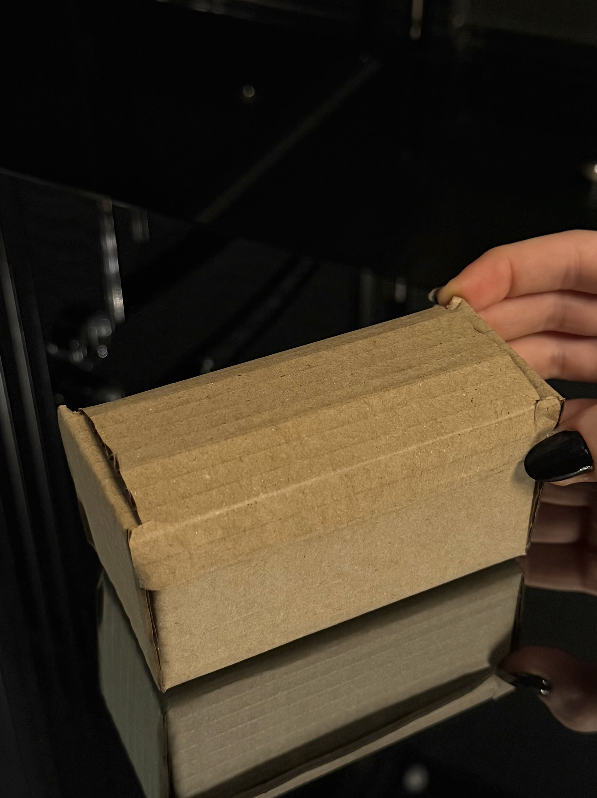
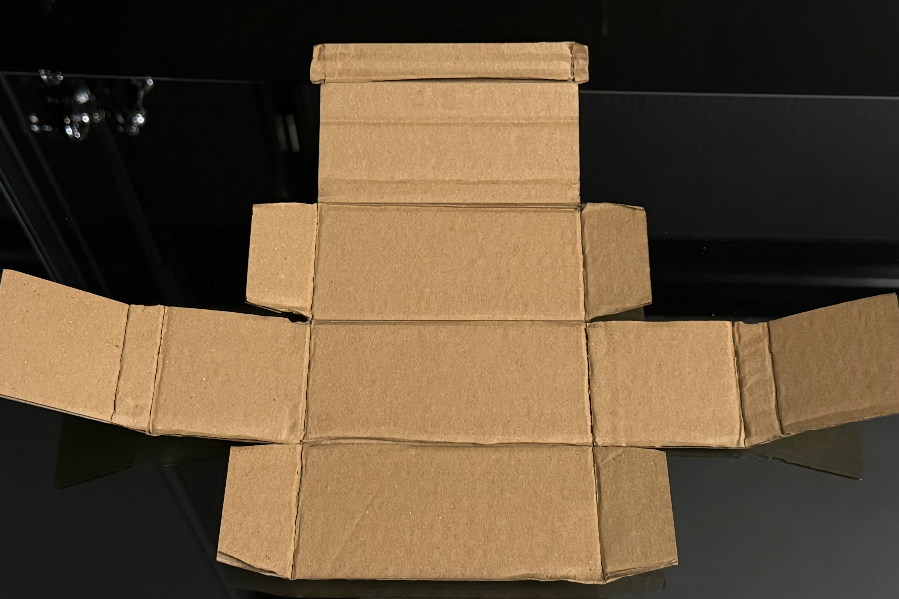

+++
date = '2026-10-20T20:58:37+03:00'
draft = false
title = 'Laser Cut Box'
+++
## Laser Cut Box

### Overview

For this part of Assignment 2, I designed and laser-cut a foldable cardboard box to hold the individual components of my 3D-printed rocket.

I created the box layout in Fusion 360, separating the cutting lines from the folding lines. The goal was to make a box that could be cut from a flat sheet of cardboard and folded into its final shape.

### Tools and Materials

- Fusion 360
    
- Laser cutter
    
- Cardboard
    
- DXF files for cutting and scoring
    

### Design Process

I started by creating a flat box layout in Fusion 360. I needed to consider the dimensions of the rocket components so that they could fit inside the box without being assembled.

I prepared two separate drawings: one for the outer cutting lines and another for the score lines.

The cut lines define the parts of the cardboard that need to be separated, while the score lines mark where the cardboard should fold.

I exported both drawings as DXF files to prepare them for the laser cutter.

**Cut lines — Fusion 360**

**Score lines — Fusion 360**

### Laser Cutting and Assembly

After preparing the design, I used the laser cutter to cut and score the cardboard.

Once the cutting process was complete, I removed the cardboard from the machine and folded it along the scored lines to form the box.

The flat design became a three-dimensional structure without needing to print separate components.

### Challenges

I did not experience any major problems during the laser cutting or assembly process. The cut and score lines worked as intended, and I was able to fold the cardboard into its final shape without much difficulty.

One important part of the process was keeping the cut and score lines separate, since they serve different purposes.

### Final Result

*The assembled cardboard box.*

*The box showing its folding structure.*

The final result was a foldable cardboard box made using the laser cutter.

The box can be opened and folded, and it was designed to hold the separate pieces of my 3D-printed rocket.

### What I Learned

This assignment helped me understand how a flat 2D design can become a three-dimensional object through cutting and folding.

I also learned why it is important to prepare cut and score lines separately when working with a laser cutter.

### Download Design Files

To make my box design accessible to others, I included the original Fusion 360 file and the DXF files used for laser cutting and scoring.

**Fusion 360 Design:**

[Download Fusion 360 Design (F3D)](Kutu.f3d)

**Laser Cutting Files:**

[Download Cut and Score Files (ZIP)](Laser-Cut-Box-DXF-Files.zip)