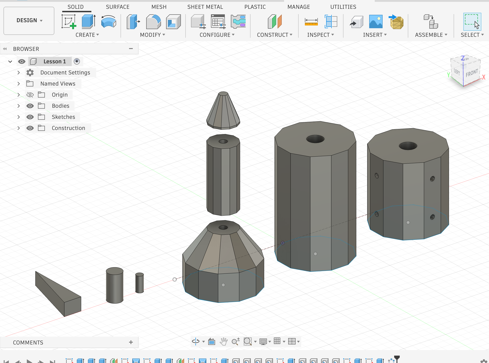
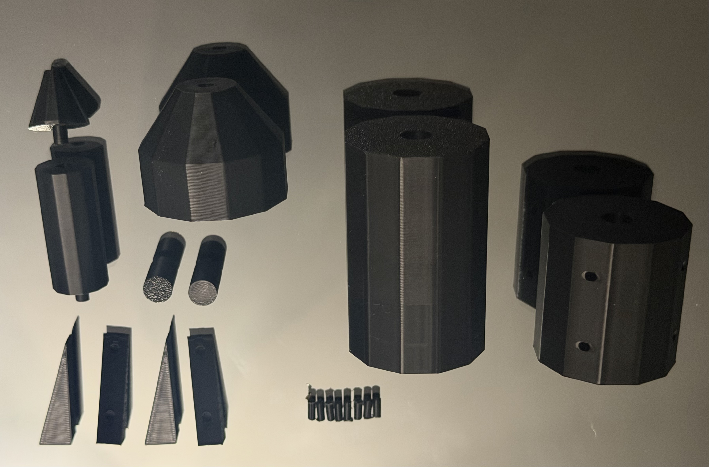

## Fusion 360 — Rocket Design

### Overview

This week, I used Fusion 360 to model a rocket made up of several individual components. I started with sketches based on hexagonal geometry and used **Extrude** to turn the profiles into 3D forms. For the tapered sections, I created sketches at different heights using **Offset Plane** and connected the profiles with **Loft**. I used the **Hole** feature to create precise openings in the components, and **Circular Pattern** to repeat features evenly around the body.

### Tools Used

`Sketch` · `Polygon` · `Extrude` · `Offset Plane` · `Loft` · `Hole` · `Circular Pattern`

### Challenges

One of the main challenges was understanding how different features depend on the geometry created before them. Working with Offset Planes and Loft required me to think about where each profile needed to be placed, while features such as Hole and Circular Pattern required careful selection and positioning.

### What I Learned

This project helped me understand how a complex 3D object can be built from relatively simple sketches and features. I also became more comfortable combining different Fusion 360 tools instead of treating each tool separately.

### 3D Printing Process

After completing my rocket design in Fusion 360, I used a Bambu Lab 3D printer to turn the digital model into physical components.

Instead of printing the rocket as one solid object, I printed the different parts separately. The goal was to create a kit that could be assembled and disassembled.

The printed components included body sections, tapered pieces, fins, and smaller connecting parts.

### Challenges During Assembly

After printing the rocket components, I tried fitting the pieces together. Some of the connections were slightly loose, even though the dimensions had seemed correct in Fusion 360.

I decided to keep the printed parts as they were rather than printing them again. The loose connections did not require another print, but they helped me understand how important tolerances are when designing parts that need to fit together.

If I were to improve the design, I would adjust the dimensions of the connecting parts to create a tighter fit.

### Final Result

I printed the individual rocket components using the Bambu Lab 3D printer. Seeing the physical pieces helped me compare my Fusion 360 design with the actual printed result.

Although some connections were looser than I intended, the project helped me understand the difference between designing parts digitally and making them fit together in real life.

### Download 3D Design Files

To make my rocket design accessible to others, I included the original Fusion 360 archive and the STL file used for 3D printing.

[Download Rocket Design Files (ZIP)](Assignment-02-Rocket-Design-Files.zip)